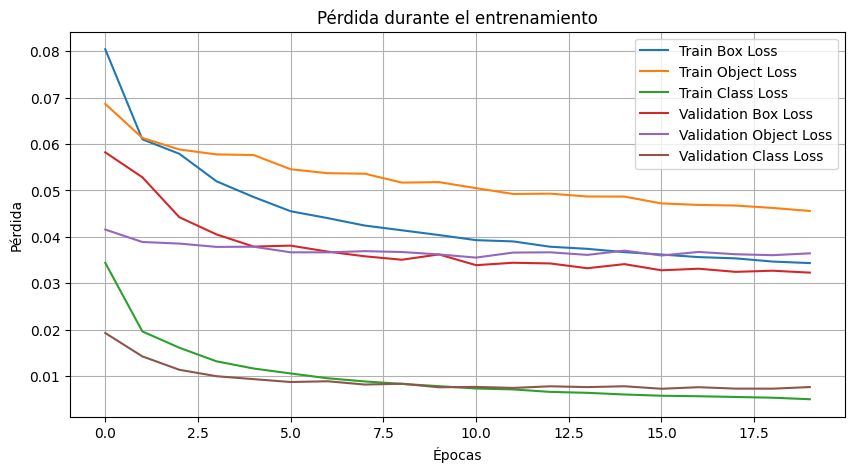
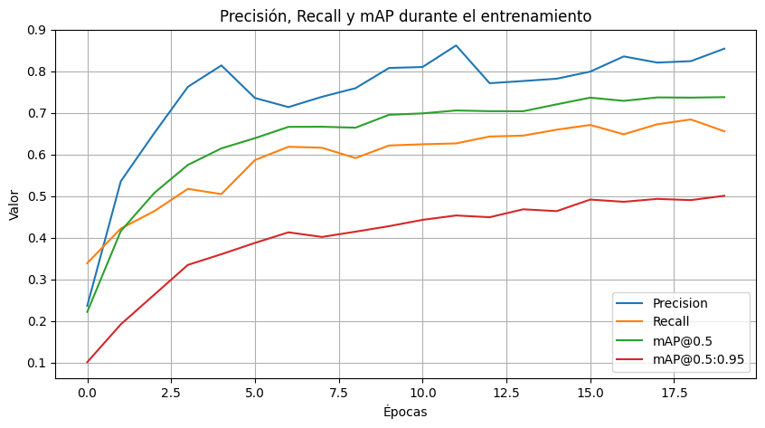
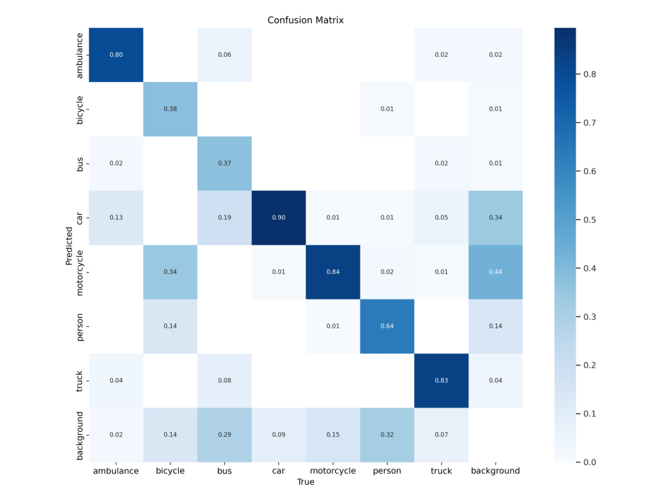

# Urban Traffic Object Detection with YOLOv5

Academic computer vision project (2024) focused on detecting and classifying objects in urban traffic scenes using **YOLOv5s**.

> **Portfolio note:** This repository presents an existing group project and its documented experimental results. It is not a newly retrained model or a production-ready traffic-monitoring system.

## Overview

The workflow covers dataset exploration, bounding-box visualization, image augmentation, model training, evaluation and inference examples in a Google Colab notebook.

**Classes (9):** ambulance, bicycle, bus, car, motorcycle, person, truck, traffic light and signal.

| Configuration | Value |
| --- | --- |
| Architecture | YOLOv5s |
| Input image size | 512 px |
| Training epochs | 20 |
| Batch size | 32 |
| Dataset split | 1,089 train / 316 validation / 138 test images |
| Training environment | Google Colab |

The notebook uses Google Drive and `/content/` paths from the original environment. **Those paths must be updated before rerunning it.** The original data configuration also refers to `/content/Dataset_2`; `data.yaml.example` shows a portable layout.

## Reported results

The original notebook reports these metrics on the **validation set** (316 images, 3,587 labeled instances). They have not been independently reproduced during portfolio preparation.

| Metric | Validation result |
| --- | ---: |
| Precision | 0.854 |
| Recall | 0.656 |
| mAP@0.5 | 0.738 |
| mAP@0.5:0.95 | 0.501 |

### Training and validation visualizations







## Repository structure

```text
.
├── notebooks/
│   └── urban_traffic_yolov5.ipynb
├── assets/
│   ├── training_curves.png
│   ├── validation_metrics.png
│   └── confusion_matrix.png
├── data.yaml.example
├── README.md
├── README_ES.md
├── REPOSITORY_NOTES.md
└── .gitignore
```

## How to reproduce the workflow

1. Open `notebooks/urban_traffic_yolov5.ipynb` in Google Colab.
2. Obtain a dataset with the nine classes, respecting each source's usage terms. Place it under `data/` using `train`, `valid` and `test` subfolders with `images/` and `labels/` directories.
3. Adapt `data.yaml.example` and the original notebook's Google Drive and Colab paths.
4. Follow the notebook steps to install/clone YOLOv5, explore the data, train and evaluate the model.

The historical notebook includes shell commands, package installation and links to external repositories. Review commands and dependencies before running them in your own environment. Model weights (`best.pt`) and the full image dataset are **not bundled** in this lightweight publication.

## Dataset and licensing

The archived data configuration references [Traffix Vehicles on Roboflow Universe](https://universe.roboflow.com/nota-bota-xf6nm/traffix-vehicles/dataset/7), which lists CC BY 4.0 in its metadata. The notebook describes combining multiple dataset sources, so that license **must not be assumed to cover every original image**. Verify each source and its attribution requirements before redistributing data or model weights.

## Team and contribution

Academic group: **Fabian Rojas, José Escobar, Armando Galaz and Matías Villanueva**.

Fabian Rojas and José Escobar collaborated closely on the project's technical work. This portfolio presentation credits the whole team; it does not represent the project as individual work. For details about the original exercise and publication limitations, see [repository notes](REPOSITORY_NOTES.md).

---

**Español:** [README_ES.md](README_ES.md)
