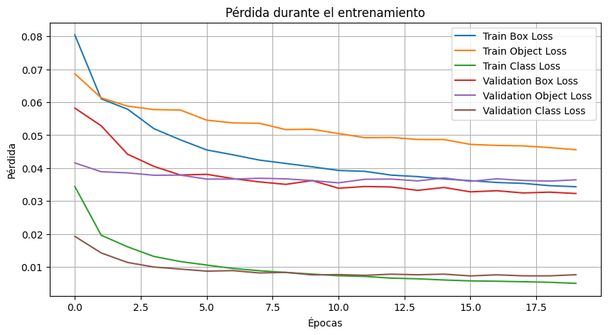
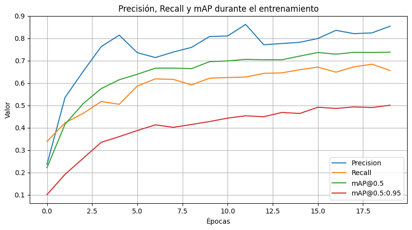
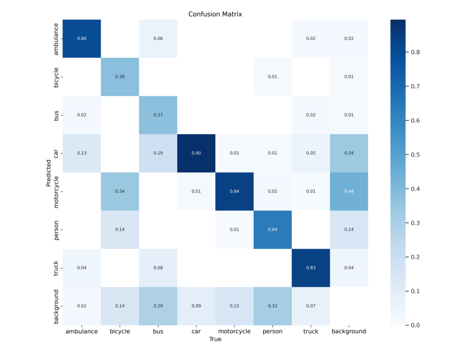

# Detección de objetos en tráfico urbano con YOLOv5

Proyecto académico de visión por computador (2024) para detectar y clasificar objetos presentes en escenas de tránsito usando **YOLOv5s**.

> **Sobre este portafolio:** se presenta un trabajo grupal ya realizado, con los resultados documentados en el notebook original. No se reentrenó el modelo para preparar esta publicación y no se trata de un sistema listo para producción.

## ¿Qué se hizo?

El trabajo incluye exploración del conjunto de imágenes, visualización de cajas delimitadoras (*bounding boxes*), aumento de datos, entrenamiento, evaluación y ejemplos de inferencia mediante Google Colab.

**Nueve clases:** ambulancia, bicicleta, bus, automóvil, motocicleta, persona, camión, semáforo y señal de tránsito.

| Configuración | Valor |
| --- | --- |
| Arquitectura | YOLOv5s |
| Tamaño de imagen | 512 px |
| Épocas | 20 |
| Batch size | 32 |
| División del dataset | 1.089 entrenamiento / 316 validación / 138 prueba |
| Entorno | Google Colab |

## Resultados del experimento

Métricas **de validación** registradas en el notebook original: 316 imágenes y 3.587 instancias etiquetadas. No se volvieron a ejecutar para esta versión del portafolio.

| Métrica | Resultado |
| --- | ---: |
| Precisión | 0,854 |
| Recall (exhaustividad) | 0,656 |
| mAP@0.5 | 0,738 |
| mAP@0.5:0.95 | 0,501 |

## Archivos y ejecución

- [`notebooks/urban_traffic_yolov5.ipynb`](notebooks/urban_traffic_yolov5.ipynb): desarrollo del experimento.
- `assets/`: gráficos extraídos de sus resultados originales.
- [`data.yaml.example`](data.yaml.example): ejemplo de rutas relativas del dataset.
- [`REPOSITORY_NOTES.md`](REPOSITORY_NOTES.md): consideraciones sobre reproducibilidad y publicación.

Para repetir el experimento se necesita preparar un dataset compatible, instalar las dependencias indicadas en el notebook y **ajustar sus rutas originales de Google Drive y `/content/`**. El notebook fue conservado como registro histórico: no garantiza ejecución inmediata en un entorno nuevo.

Los pesos `best.pt` y el dataset de imágenes completo **no se incluyen** para mantener liviano el repositorio y revisar primero los permisos de redistribución.

## Fuentes de datos

La configuración archivada menciona [Traffix Vehicles en Roboflow Universe](https://universe.roboflow.com/nota-bota-xf6nm/traffix-vehicles/dataset/7), con licencia CC BY 4.0 indicada en sus metadatos. Como el trabajo también habla de combinar fuentes, esa licencia no necesariamente aplica a todas las imágenes. Es importante verificar las condiciones de cada origen antes de publicar el dataset completo.

## Autores y colaboración

**Fabian Rojas, José Escobar, Armando Galaz y Matías Villanueva.**

Fabian Rojas y José Escobar trabajaron estrechamente en el desarrollo técnico. Se reconoce la participación del equipo completo porque fue un proyecto académico grupal.

---

**English:** [README.md](README.md)
